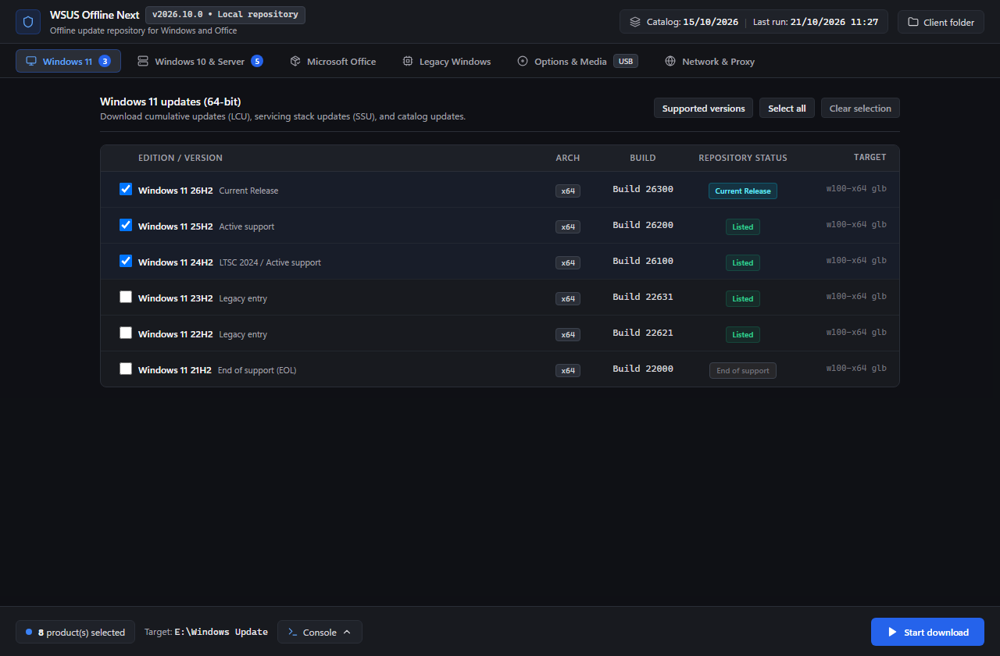
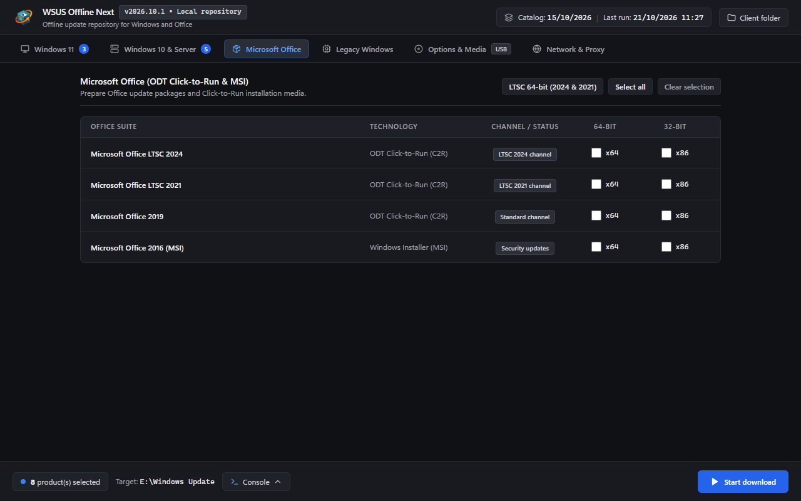
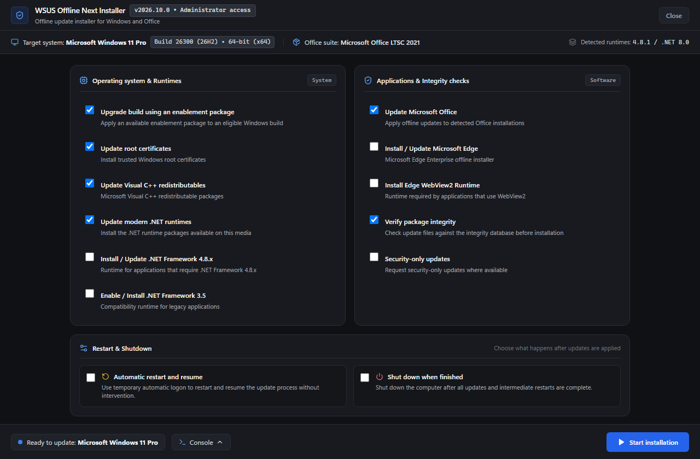
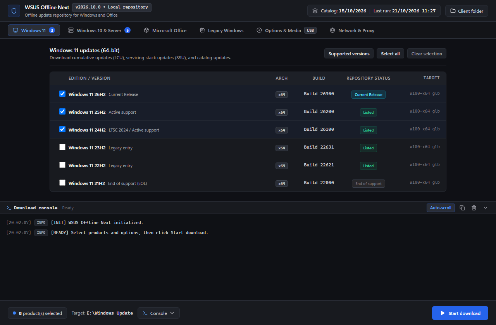
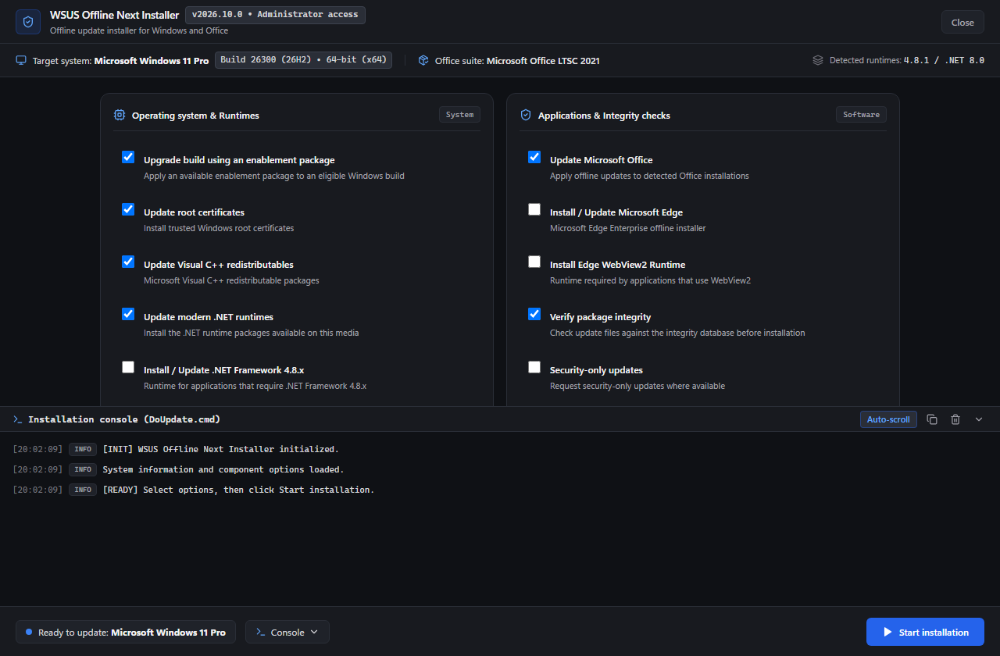

<div align="center">


# WSUS Offline Next

### Prepare online. Update offline.

**A modern, independent successor to WSUS Offline Update Community Edition.**

[](RELEASE_NOTES.md)
[](#requirements)
[](doc/license.txt)
[](https://liberapay.com/Jeremie/)
[](https://www.linkedin.com/in/jeremiedufault)

[Quick start](#quick-start) · [Screenshots](#screenshots) · [Release notes](RELEASE_NOTES.md) · [Coverage](#coverage) · [Command line](#command-line) · [Build from source](#build-from-source) · [Support & connect](#support--connect)

Download Windows and Office updates on a connected computer, prepare reusable update media, and service machines without Internet access. Built for technicians, system administrators, and offline environments.



*Generator browser preview. Repository dates and machine information shown in the screenshots are illustrative; they are not evidence of a completed download or installation.*

</div>

## What's new

The familiar **Generator → client media → Installer** workflow continues, with a modern desktop interface and expanded servicing capabilities.

| Improvement | What it brings |
| :--- | :--- |
| **Modern desktop apps** | English interfaces, compact product tables, bulk selection, and integrated timestamped consoles. React and TypeScript run inside .NET 8 / WebView2 hosts. |
| **Recent Windows servicing** | A shared build registry, enablement-package eligibility checks, and checkpoint-first ordering for cumulative updates on the 26100 servicing branch. |
| **Office MSI + Click-to-Run** | Office 2016 MSI catalog updates alongside Office 2019, LTSC 2021, and LTSC 2024 staging through the Office Deployment Tool (ODT). |
| **Audit before installing** | The `/auditonly` script option reports Windows and Office update applicability without installing updates. |
| **Modern components** | Optional Edge, WebView2, Defender definitions, Visual C++, .NET Framework, and .NET 8 / 10 runtime packages. |
| **Integrity and diagnostics** | Hash verification, fail-closed checks in servicing paths, execution reports, and restart-loop protection. Keep verification enabled when preparing and applying media. |

The application version is **2026.10.2**. Read the [release notes](RELEASE_NOTES.md) for changes, upgrade guidance, and known limitations. Internal milestones such as `v4.0` describe development stages, not a separate application release number.

## Screenshots

These captures show the actual English frontend at **1280 × 840**, rendered as browser previews. Consoles are idle; no download, installation, or restart was performed to produce them.

### Prepare Office media

Choose Click-to-Run products and architectures. Office 2016 MSI is also listed; its current script-based download path is explained under [coverage](#coverage).



### Configure the offline installer

Select runtime and application updates, enable integrity checks, and choose restart behavior. Machine details in this preview are sample data.



<details>
<summary><strong>See the download and installation consoles</strong></summary>

**Download console** — timestamped messages, automatic scrolling, and copy/clear controls.



**Installation console** — the same controls alongside the client update options.



</details>

## How it works

```text
CONNECTED COMPUTER                PORTABLE MEDIA                 OFFLINE COMPUTER
Select products and download  →   Copy the complete client/  →   Audit or install
Windows catalog + Office ODT      directory to a USB drive       using the Installer
```

Windows and MSI Office discovery use Microsoft's `wsusscn2.cab` catalog. Click-to-Run Office packages use a separate ODT pipeline. The prepared client directory contains the scripts, metadata, and downloaded packages needed on the destination computer.

Coverage depends on the catalog, available packages, and the destination system. This is not a complete replacement for online Windows Update, and enablement packages do not provide arbitrary Windows version upgrades.

## Requirements

| Where | What you need |
| :--- | :--- |
| **Preparation computer** | Windows x64 for the modern Generator, Internet access to the update sources, a writable project directory, and enough free space for the selected packages and any media copies. |
| **Both modern desktop apps** | The **.NET 8 Desktop Runtime (x64)** and **Microsoft Edge WebView2 Runtime**, installed before launching the application. Single-file publishing does not bundle these runtimes. |
| **Offline destination** | A compatible Windows installation, the complete prepared client directory, and administrator privileges to apply updates. Preinstall the desktop runtimes if using the modern Installer. |
| **Script-based use** | The included Windows scripts and their required utilities. These do not require the React/WebView2 interface; the available package architecture still needs to match the destination. |

Runtime downloads: [.NET 8 Desktop Runtime](https://dotnet.microsoft.com/en-us/download/dotnet/8.0) · [WebView2 Runtime](https://developer.microsoft.com/en-us/microsoft-edge/webview2/)

Offline updating does not provide Windows ESU entitlement or Office activation. Package availability and eligibility still depend on the relevant product and license.

## Quick start

### 1. Prepare updates on the connected computer

1. Start with a built copy of the project. A source checkout requires the [build steps below](#build-from-source); generated executables are not tracked in Git.
2. Launch **`UpdateGenerator.exe`** from the project root.
3. Select the Windows versions and Office Click-to-Run products you need. Under **Options & Media**, choose additional components and keep **Verify downloaded files** enabled.
4. Check the USB destination before enabling copying, or disable copying to prepare the local repository first. Click **Start download** and inspect the console and `log/download.log` for failures.
5. Transfer the **complete `client/` directory**, including scripts, integrity data, `office/` packages when selected, and `wwwroot/` assets when present, to the destination media. Copying the full directory preserves Office content; the modern host's automatic media jobs are driven by selected Windows targets.

ISO creation produces update-data images, not bootable Windows installation media. Office-only selections do not schedule an ISO or USB-copy job in the current modern host.

### 2. Apply updates on the offline computer

1. Open the copied client directory and launch **`UpdateInstaller.exe`** with administrator privileges.
2. Review the detected system, select the required updates, and keep **Verify package integrity** enabled.
3. Leave automatic restart and shutdown disabled unless you want those actions. Click **Start installation**.
4. Review the console and logs. If a restart is required, restart and run the Installer again, or use **Automatic restart and resume** when appropriate.

To audit first, open an elevated Command Prompt in the copied client directory and run:

```cmd
cmd\DoUpdate.cmd /auditonly
```

The audit writes a report rather than installing packages. See [command line](#command-line) for report locations and additional examples.

## Coverage

This table describes the repository's implementation, not a guarantee of current Microsoft support or package availability. Consult [Microsoft's Windows release information](https://learn.microsoft.com/en-us/windows/release-health/windows11-release-information) for edition-specific servicing dates.

| Product or component | Engine coverage | Modern interface / qualification |
| :--- | :--- | :--- |
| **Windows 11 x64** | 24H2 / 26100, 25H2 / 26200, 26H2 / 26300 entries; checkpoint and enablement logic | Listed in Generator. Older entries remain visible; a row does not establish current lifecycle support. |
| **Windows 11 26H1 / 28000** | Separate branch handling; registry marks it `ineligible` for the normal upgrade path | No 26H1 selection in the modern Generator. Do not treat it as an upgrade from the 26100 branch. |
| **Windows 10** | x86 and x64 servicing entries, including the 19041–19045 family | Listed in Generator. ESU updates require applicable entitlement. |
| **Windows Server** | Server 2016 / 14393, 2019 / 17763, 2022 / 20348 | x64 selections in the Windows 10 & Server tab. |
| **Office 2019 / LTSC 2021 / LTSC 2024** | ODT staging and offline Click-to-Run client servicing, x86 and x64 | Generator forwards these selections to the ODT download script. |
| **Office 2016 MSI** | WSUS catalog pipeline, x86 and x64 | Checkboxes are visible, but the modern host does not schedule the MSI download. Use the CLI examples below. |
| **Optional components** | Edge, WebView2, Defender definitions, Visual C++, .NET Framework, .NET 8 / 10 packages | Availability varies by architecture and prepared media. |
| **Legacy Windows** | Historical selections and scripts remain | Package availability and applicability depend on existing media and update sources. A visible entry is not a guarantee of usable updates for XP, Vista, or Windows 7. |

<details>
<summary><strong>Current modern-interface limitations</strong></summary>

- **Network & Proxy:** fields are displayed, but the modern Generator host does not forward proxy or WSUS settings to the download engine. Use `DownloadUpdates.cmd` with `/proxy`, `/wsus`, or `/wsusonly` as needed.
- **Audit:** `/auditonly` is available through the client script; the modern Installer currently has no visible audit control.
- **Repository metadata:** the Generator's catalog date and last-run display currently use frontend defaults. Check files and logs for actual freshness.
- **Saved settings:** do not assume every modern-interface setting survives a restart; review the selection and destination before each run.
- **Office media:** use the complete `client/` directory for transfer. The modern host does not create media jobs for Office-only selections.

</details>

## Command line

Run these examples from the **project root** in Command Prompt. Use an elevated prompt for client installation and audit commands.

<details>
<summary><strong>Download Windows and Office packages</strong></summary>

```cmd
rem Windows x64: selected builds, runtimes, Defender, Edge, and WebView2
cmd\DownloadUpdates.cmd w100-x64 glb /includedotnet /includewddefs /includeedge /includewebview2 /verify

rem Office LTSC 2024 Click-to-Run, 64-bit, English
cmd\DownloadOfficeC2R.cmd o2k24 x64 en-us

rem Office 2016 MSI catalog updates, 64-bit or 32-bit
cmd\DownloadUpdates.cmd o2k16-x64 glb /verify
cmd\DownloadUpdates.cmd o2k16 glb /verify
```

`w100-x64` is the shared Windows x64 download target, including Windows 11; it is not limited to Windows 10. Build selection is stored in `Windows10Versions.ini`. Office C2R accepts `o2k19`, `o2k21`, or `o2k24`, followed by `x86` or `x64` and an optional language.

</details>

<details>
<summary><strong>Audit, install, and inspect reports</strong></summary>

```cmd
rem Report missing updates without installing them
client\cmd\DoUpdate.cmd /auditonly

rem Apply Windows updates and service detected Office installations
client\cmd\DoUpdate.cmd /verify /updateoffice /showlog
```

| Option | Purpose |
| :--- | :--- |
| `/auditonly` | Generate an applicability report; logs and temporary report files are still written. |
| `/verify` | Verify package integrity before installation. |
| `/updateoffice` | Service detected Office installations using prepared media. |
| `/updatecpp` | Install the prepared Visual C++ redistributables. |
| `/updatedotnet5` | Historical switch name for modern .NET runtime packages, including newer versions. |
| `/autoreboot` | Enable temporary automatic logon and restart/resume handling. |
| `/shutdown` | Shut down after servicing completes. |
| `/showlog` | Open the installation log at completion. |

Audit output normally goes to `log/MissingUpdates.txt` relative to the project root, with `%SystemRoot%\wsusofflineupdate_MissingUpdates.txt` as the fallback. Execution summaries use `log/DoUpdate.log` when available; the main client log defaults to `%SystemRoot%\wsusofflineupdate.log`.

</details>

## Build from source

Use Windows x64 with **Node.js/npm** and the **.NET 8 SDK**. The SDK builds the hosts; the Desktop Runtime and WebView2 are needed to run them. Initial npm and NuGet dependency restoration requires network access.

From the project root in PowerShell:

```powershell
npm --prefix src-modern/generator ci
npm --prefix src-modern/installer ci
.\CompileModernApps.cmd --no-pause
```

The script builds both React frontends and publishes the hosts to `UpdateGenerator.exe` and `client/UpdateInstaller.exe`, with corresponding `wwwroot/` assets. Keep these generated files together with the project's scripts and data when preparing a distributable copy.

<details>
<summary><strong>Development and verification</strong></summary>

Preview either interface in a browser:

```powershell
npm --prefix src-modern/generator run dev
npm --prefix src-modern/installer run dev
```

Browser mode previews the UI with sample data; native commands require the .NET/WebView2 host. It is not an offline servicing test.

The repository includes focused verification scripts:

```powershell
.\tests\verify-gui-contracts.cmd
.\tests\verify-offline-audit.cmd
.\tests\verify-checkpoint-servicing.cmd
.\tests\verify-win11-26h1.cmd
.\tests\verify-c2r-servicing.cmd
```

The GUI contract suite checks the historical AutoIt interfaces; it does not replace testing the modern React/WebView2 bridge. Inspect individual test prerequisites before running them. The historical AutoIt build remains available through `CompileAutoItScripts.cmd`; it writes to the same executable destinations, so run the modern build last when using the modern UI.

Windows download and installation engines remain under `cmd/` and `client/cmd/`. Bash preparation tooling lives under `sh/`; its prerequisites and supported invocation are documented in that tree. Desktop installation remains Windows-specific.

</details>

## Support & connect

If WSUS Offline Next helps you maintain offline computers, you can support its development through [Liberapay](https://liberapay.com/Jeremie/).

Connect with the maintainer on [LinkedIn](https://www.linkedin.com/in/jeremiedufault) for professional conversations and project updates.

## Credits and license

WSUS Offline Next builds on **WSUS Offline Update**, originally developed by **Torsten Wittrock**, and the work of the **WSUS Offline Update Community Edition** contributors. This independent continuation is maintained in [CatFoxVoyager/WsusOfflineNext](https://github.com/CatFoxVoyager/WsusOfflineNext).

The repository includes the **GNU General Public License, version 3**. See [the license text](doc/license.txt) and [upstream history](doc/history.txt). Third-party tools retain their respective licenses. This project is not a Microsoft product.
