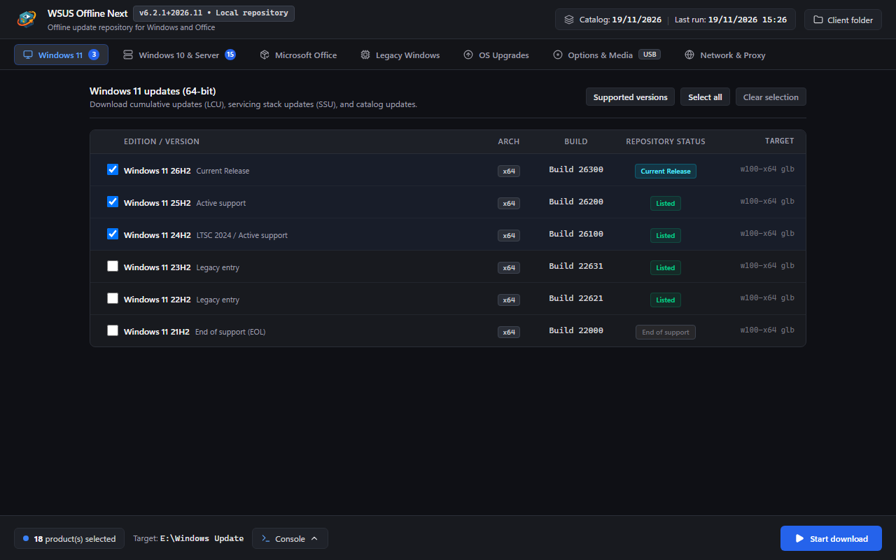
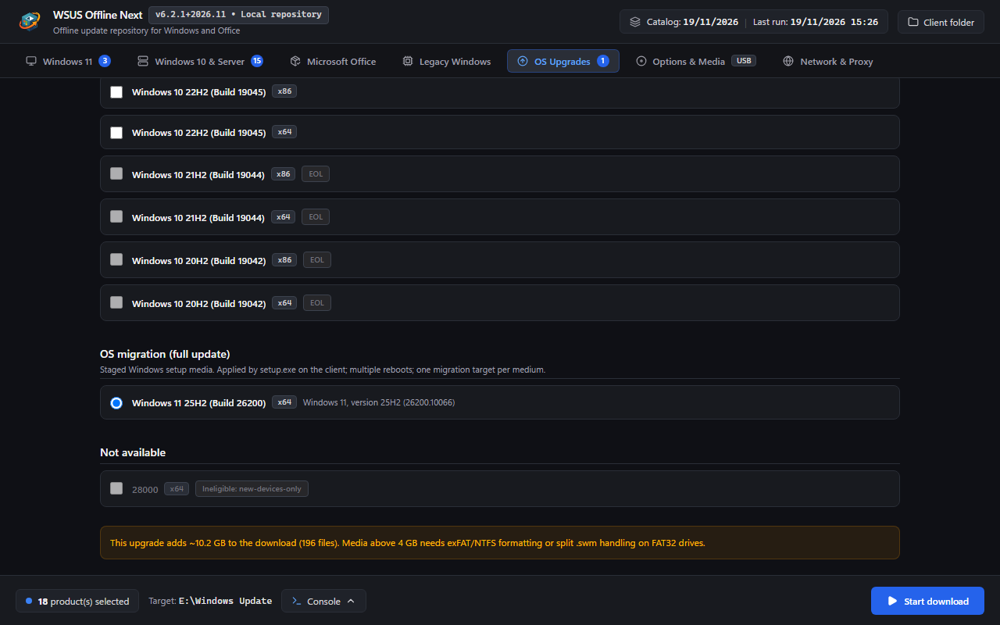
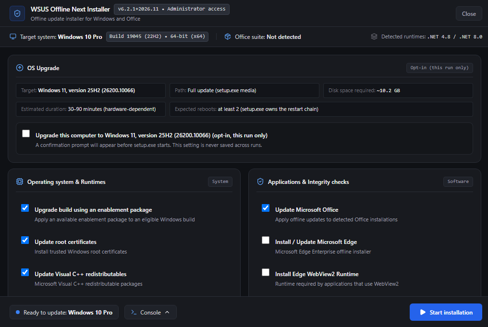
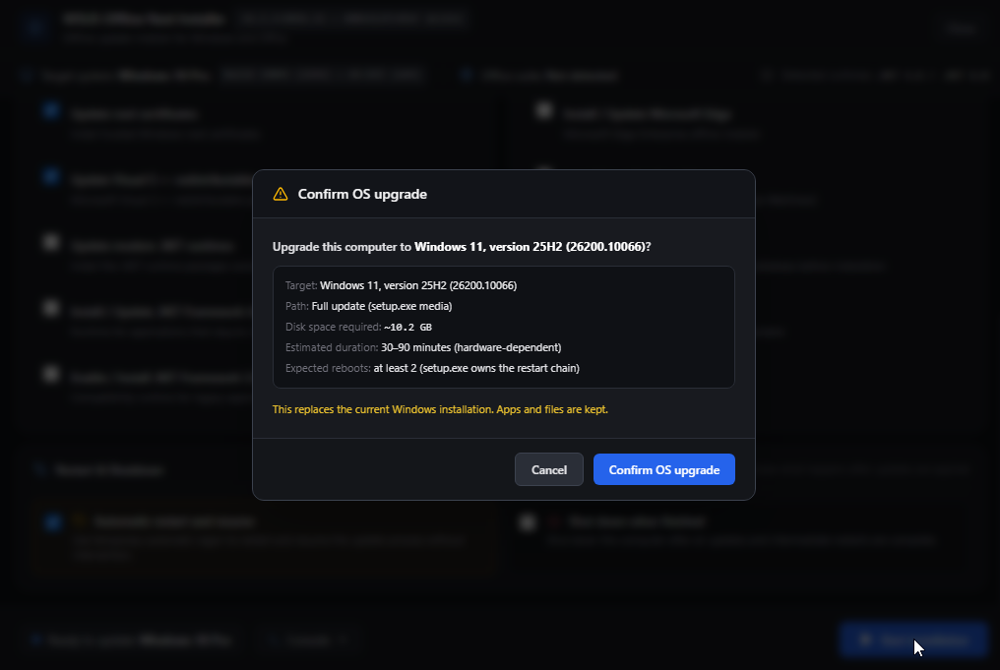
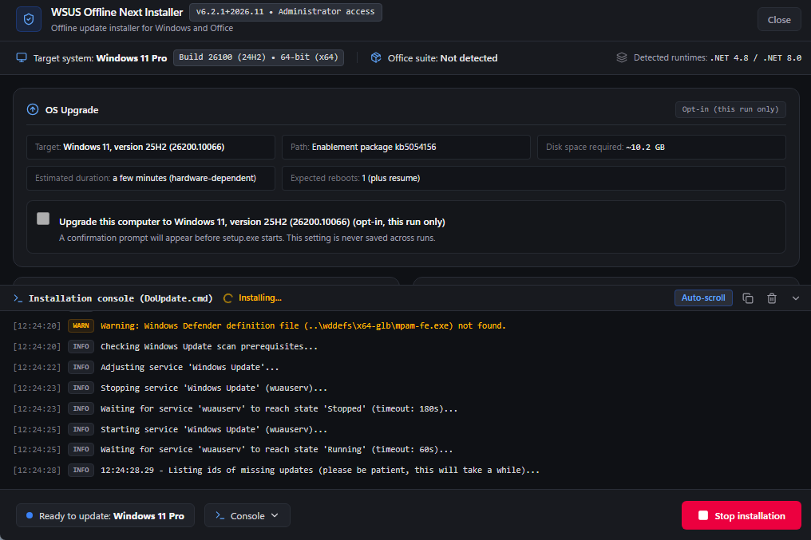

<div align="center">


# WSUS Offline Next

Downloads Windows and Office updates on a connected machine and packages them into a portable `client/` directory that installs them on computers without Internet access.
Batch download and install engines, .NET 8 / WebView2 (React) desktop apps, and a native Free Pascal/Lazarus fallback installer.

[](RELEASE_NOTES.md)
[](#requirements)
[](doc/license.txt)



</div>

Independent successor to WSUS Offline Update Community Edition. Current version: **6.4.0+2026.11** ([release notes](RELEASE_NOTES.md)).

## Features

- **Windows updates** from Microsoft's `wsusscn2.cab` catalog: Windows 11 (24H2, 25H2, 26H2), Windows 10 (x86/x64), Server 2016/2019/2022. Checkpoint-first ordering of cumulative updates and enablement-package eligibility checks on the 26100 branch.
- **Offline OS upgrades (Windows 10 & 11)**: in-branch enablement packages (EKB) and full feature-update media (`setup.exe`, including Windows 10 → Windows 11 25H2) selected in the Generator's **OS Upgrades** tab and applied on the client via an explicit 5-fact opt-in confirmation (never persisted across runs).
- **Post-reboot resume**: handles `3010`/`3011` restarts with an in-app restart prompt and upgrade-surviving `/resume` persistence (`RunOnce`, `\WOUResume` Scheduled Task, `%ProgramData%\WSUSOffline`).
- **Office**: 2016 MSI through the WSUS catalog; 2019, LTSC 2021, and LTSC 2024 Click-to-Run through the Office Deployment Tool (ODT).
- **Optional packages**: Edge, WebView2, Defender definitions, Visual C++, .NET Framework, .NET 8/10 runtimes.
- **Audit mode**: `/auditonly` reports applicable updates without installing anything.
- **Integrity**: hash verification, fail-closed servicing paths, restart-loop protection.
- **Offline runtime bootstrap**: the client launcher installs missing .NET 8 Desktop and WebView2 runtimes from the media itself, otherwise it falls back to the native installer.

## Screenshots

| Generator — OS Upgrades | Modern Installer — OS Upgrade offer |
| :---: | :---: |
|  |  |

| 5-fact OS Upgrade confirmation | Post-upgrade console & EKB adaptation |
| :---: | :---: |
|  |  |

## Quick start

Download the latest archive from [Releases](https://github.com/CatFoxVoyager/WsusOfflineNext/releases/latest) and extract it.

**1. On the connected computer:**

```cmd
UpdateGenerator.cmd
```

Select Windows builds, Office products, and any optional **OS Upgrades** targets, keep **Verify downloaded files** enabled, click **Start download**. Check `log/download.log` for errors.

**2. Copy the whole `client/` directory** to a USB drive or other media (exFAT/NTFS recommended for >4 GB upgrade media).

**3. On the offline computer** (accept the UAC prompt):

```cmd
client\UpdateInstaller.cmd
```

Keep **Verify package integrity** enabled, opt in to **OS Upgrade** if staged media is available and desired (confirmed by a 5-fact prompt), and click **Start installation**. If a restart is required (`3010`/`3011`), accept the restart prompt or enable **Automatic restart and resume**.

## Requirements

| Machine | Requirement |
| :--- | :--- |
| Preparation | Windows x64, Internet access, [.NET 8 Desktop Runtime (x64)](https://dotnet.microsoft.com/en-us/download/dotnet/8.0) and [WebView2 Runtime](https://developer.microsoft.com/en-us/microsoft-edge/webview2/), enough disk space for the selected packages. |
| Offline target | Compatible Windows install, administrator rights, the complete `client/` directory. Runtimes are installed from the media when needed. |

Offline updating does not grant Windows ESU entitlement or Office activation.

## Command line

Download (from the project root):

```cmd
rem Windows x64 (includes Windows 11) with .NET, Defender, Edge, WebView2
cmd\DownloadUpdates.cmd w100-x64 glb /includedotnet /includewddefs /includeedge /includewebview2 /verify

rem Stage offline OS upgrade media (example: Windows 11 25H2 build 26200)
cmd\DownloadUpdates.cmd w100-x64 glb /includeupgrade:26200 /verify

rem Office Click-to-Run: o2k19 | o2k21 | o2k24, then x86 | x64, optional language
cmd\DownloadOfficeC2R.cmd o2k24 x64 en-us

rem Office 2016 MSI, x64 or x86
cmd\DownloadUpdates.cmd o2k16-x64 glb /verify
cmd\DownloadUpdates.cmd o2k16 glb /verify
```

The Windows build selection is stored in `Windows10Versions.ini`. Proxy and WSUS: `/proxy`, `/wsus`, `/wsusonly`.

Install or audit (elevated prompt):

```cmd
client\cmd\DoUpdate.cmd /auditonly
client\cmd\DoUpdate.cmd /verify /updateoffice /showlog
client\cmd\DoUpdate.cmd /upgradeos:26200 /autoreboot
```

| Option | Effect |
| :--- | :--- |
| `/auditonly` | Write an applicability report, install nothing. |
| `/upgradeos:<build>` | Opt-in offline OS upgrade to `<build>` (per-run only, never persisted to INI). |
| `/verify` | Verify package integrity before installation. |
| `/updateoffice` | Service detected Office installations. |
| `/updatecpp` | Install Visual C++ redistributables. |
| `/updatedotnet5` | Install modern .NET runtimes (legacy switch name). |
| `/autoreboot` | Register post-reboot restart/resume (`RunOnce` + `\WOUResume` on Win10+). |
| `/shutdown` | Shut down when done. |
| `/showlog` | Open the log when done. |

Logs and reports:

| File | Content |
| :--- | :--- |
| `log/MissingUpdates.txt` | Audit report (fallback: `%SystemRoot%\wsusofflineupdate_MissingUpdates.txt`) |
| `log/DoUpdate.log` | Execution summary |
| `%SystemRoot%\wsusofflineupdate.log` | Main client log |

## Self-update

The three apps (`UpdateGeneratorModern.exe`, `client\UpdateInstallerModern.exe`, `client\UpdateInstallerLegacy.exe`) check the release channel in the background at launch. Updates are SHA256-verified, applied by `WsusOfflineUpdater.exe` after the app closes, and rolled back automatically if the new version fails to start. The previous files are kept in a `wsusoffline.bak-YYYYMMDD-HHMMSS` folder.

To disable it, in `client\UpdateInstaller.ini`:

```ini
[Control]
SkipSelfUpdate=Enabled
```

On Windows 7, the HTTPS check requires TLS 1.2 to be enabled system-wide ([KB3140245](https://support.microsoft.com/help/3140245)).

## Known limitations

- The modern Generator does not schedule Office 2016 MSI downloads and does not forward proxy/WSUS settings. Use the command line above.
- The modern Installer has no audit control. Use `/auditonly`.
- Office-only selections do not create ISO or USB-copy jobs. Copy `client/` manually.
- ISO output contains update data only; it is not bootable installation media.
- Windows 11 26H1 (build 28000) is not selectable and is excluded from the normal upgrade path.
- Legacy entries (XP, Vista, 7) remain, but update availability depends on existing media and sources.

## Build from source

Requires Windows x64, Node.js/npm, and the .NET 8 SDK. PowerShell, from the project root:

```powershell
npm --prefix src-modern/generator ci
npm --prefix src-modern/installer ci
.\CompileModernApps.cmd --no-pause
```

Outputs: `UpdateGeneratorModern.exe`, `client\UpdateInstallerModern.exe`, `client\UpdateInstallerLegacy.exe` (i386), `client\UpdateInstallerLegacy64.exe` (x64). Generated executables are not tracked in Git.

UI preview in a browser (sample data, no native commands):

```powershell
npm --prefix src-modern/generator run dev
npm --prefix src-modern/installer run dev
```

Tests:

```powershell
.\tests\verify-gui-contracts.cmd
.\tests\verify-upgrade-phase-gate.cmd
.\tests\verify-offline-audit.cmd
.\tests\verify-checkpoint-servicing.cmd
.\tests\verify-win11-26h1.cmd
.\tests\verify-c2r-servicing.cmd
```

Layout: `cmd/` (download engine), `client/cmd/` (install engine), `src-modern/` (.NET/React apps), `src-native/` (native installer), `sh/` (Bash download tooling).

## License

[GPLv3](doc/license.txt). Based on WSUS Offline Update by Torsten Wittrock and the Community Edition contributors ([history](doc/history.txt)). Not affiliated with Microsoft.

Support development on [Liberapay](https://liberapay.com/Jeremie/) · Maintainer on [LinkedIn](https://www.linkedin.com/in/jeremiedufault)
