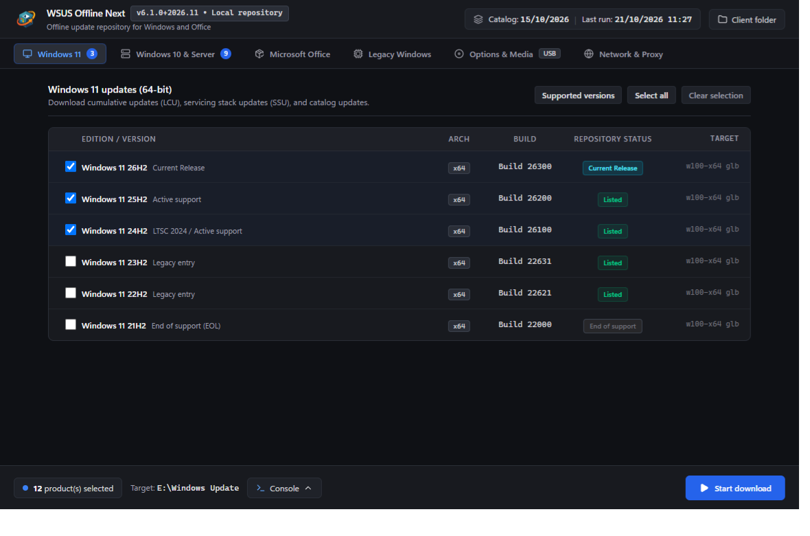
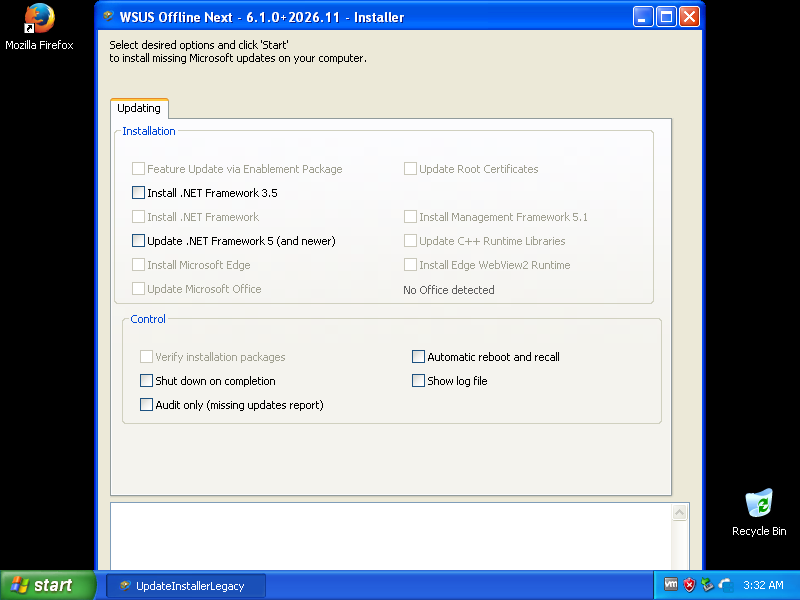
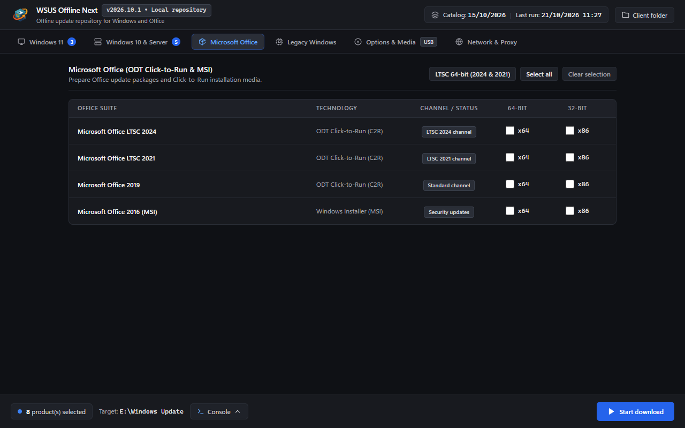
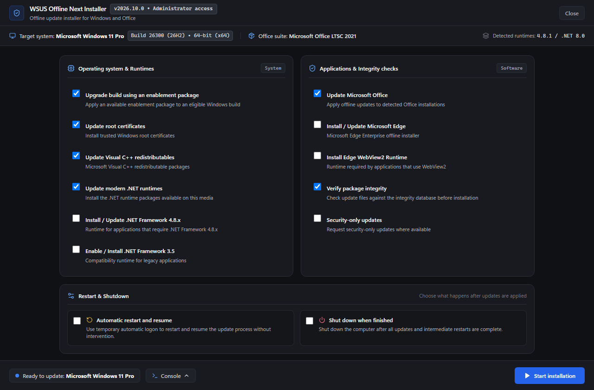
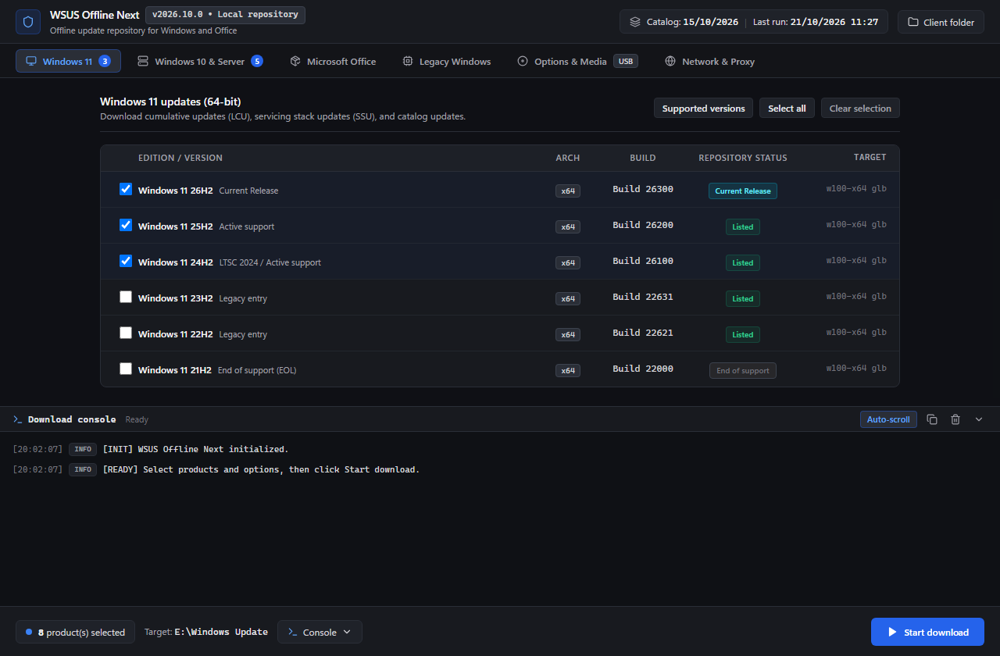
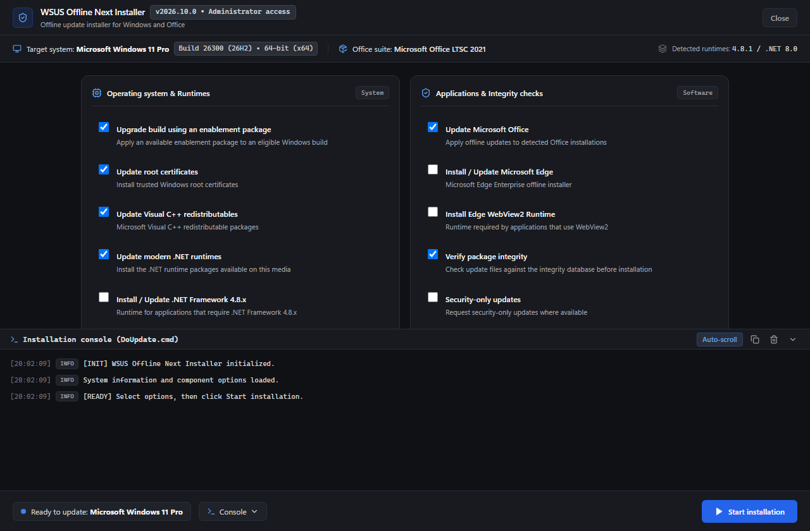

<div align="center">


# WSUS Offline Next

### Prepare online. Update offline.

**A modern, independent successor to WSUS Offline Update Community Edition.**

[](RELEASE_NOTES.md)
[](#requirements)
[](doc/license.txt)
[](https://liberapay.com/Jeremie/)
[](https://www.linkedin.com/in/jeremiedufault)

[Quick start](#quick-start) · [Screenshots](#screenshots) · [Release notes](RELEASE_NOTES.md) · [Coverage](#coverage) · [Command line](#command-line) · [Build from source](#build-from-source) · [Support & connect](#support--connect)

Download Windows and Office updates on a connected computer, build reusable update media, and service machines that have no Internet access. Built for technicians, system administrators, and air-gapped environments.



*Generator 6.1.0 running on Windows 11. The repository dates and machine information shown reflect the host's actual state; they do not indicate that a download or installation was completed.*

</div>

## What's new

> [!IMPORTANT]
> **6.0.0 is the first AutoIt-free release.** Every executable in the distribution is now a plain batch script (the `.cmd` entry points), a .NET 8 single-file host, or a native Free Pascal/Lazarus Win32 binary. All of them are compiled, carry an embedded manifest, and are version-stamped; none relies on an interpreter stub that antivirus machine-learning engines might misread. The classic AutoIt GUI, its compile toolchain, and its 152-file standard library have been removed from both the distribution and the repository. This change is why the release is a new major version.

The familiar **Generator → client media → Installer** workflow is unchanged, now with a modern desktop interface and expanded servicing capabilities.

| Improvement | What it brings |
| :--- | :--- |
| **Offline runtime bootstrap (6.1.0)** | The client launcher checks for the .NET 8 Desktop Runtime and, if it is missing, silently installs it (along with WebView2) from the offline tree, all within a single UAC prompt. Older Windows 10 machines now reach the modern interface with no manual steps; if anything is missing, the launcher safely falls back to the classic installer. |
| **AutoIt-free distribution (6.0.0)** | No interpreter-stub binaries: the launchers are plain `.cmd` scripts, the Generator is a .NET 8 single-file host, and the classic installer GUI is a native Free Pascal/Lazarus Win32 application. Validated on a live Windows 7 SP1 x86 system, and the native binaries scan clean on VirusTotal (0 malicious detections). |
| **Modern desktop apps** | English interfaces, compact product tables, bulk selection, and built-in timestamped consoles. The React and TypeScript frontends run inside .NET 8 / WebView2 hosts. |
| **Recent Windows servicing** | A shared build registry, enablement-package eligibility checks, and checkpoint-first ordering of cumulative updates on the 26100 servicing branch. |
| **Office MSI + Click-to-Run** | Office 2016 MSI catalog updates, plus Office 2019, LTSC 2021, and LTSC 2024 staging through the Office Deployment Tool (ODT). |
| **Audit before installing** | The `/auditonly` script option reports which Windows and Office updates apply, without installing anything. |
| **Modern components** | Optional Edge, WebView2, Defender definitions, Visual C++, .NET Framework, and .NET 8 / 10 runtime packages. |
| **Integrity and diagnostics** | Hash verification, fail-closed checks in servicing paths, execution reports, and restart-loop protection. Keep verification enabled when preparing and applying media. |

The application version is **6.1.0+2026.11**. See the [release notes](RELEASE_NOTES.md) for the full list of changes, upgrade guidance, and known limitations. Internal milestone labels such as `v4.0` refer to development stages, not to application release numbers.

## Screenshots

The Generator capture shows the actual .NET 8 / WebView2 application, and the legacy capture shows the native Win32 installer running on a real Windows XP system. The other interface captures are browser previews at **1280 × 840**. All consoles are idle: no download, installation, or restart was performed to produce these images.

### The classic installer on Windows XP

The native Win32 installer on a real Windows XP SP3 desktop, with version 6.1.0 shown in the title bar. Options that cannot apply to systems older than Windows 10 (Edge, WebView2, Office) are disabled in the interface, exactly as shipped.



### Prepare Office media

Choose Click-to-Run products and architectures. Office 2016 MSI is also listed; the [coverage](#coverage) section explains how it is currently downloaded through the scripts.



### Configure the offline installer

Select runtime and application updates, enable integrity checks, and choose the restart behavior. The machine details shown in this preview are sample data.



<details>
<summary><strong>See the download and installation consoles</strong></summary>

**Download console**: timestamped messages, automatic scrolling, and copy/clear controls.



**Installation console**: the same controls, shown alongside the client update options.



</details>

## How it works

```text
CONNECTED COMPUTER                PORTABLE MEDIA                 OFFLINE COMPUTER
Select products and download  →   Copy the complete client/  →   Audit or install
Windows catalog + Office ODT      directory to a USB drive       with the Installer
```

Windows and Office MSI updates are discovered through Microsoft's `wsusscn2.cab` catalog. Office Click-to-Run packages go through a separate ODT pipeline. The prepared client directory contains everything the destination computer needs: scripts, metadata, and the downloaded packages.

What gets covered depends on the catalog, the available packages, and the destination system. This tool does not fully replace online Windows Update, and enablement packages cannot upgrade Windows to an arbitrary version.

## Requirements

| Where | What you need |
| :--- | :--- |
| **Preparation computer** | Windows x64 for the modern Generator, Internet access to the update sources, a writable project directory, and enough free disk space for the selected packages and any media copies. |
| **Modern desktop apps** | The **.NET 8 Desktop Runtime (x64)** and the **Microsoft Edge WebView2 Runtime**. Single-file publishing does not bundle these runtimes. Install them on the preparation computer before launching the Generator. On the offline computer, the client launcher installs them automatically from the prepared client directory (see [Quick start](#2-apply-updates-on-the-offline-computer)). |
| **Offline destination** | A compatible Windows installation, the complete prepared client directory, and administrator rights to apply updates. |
| **Script-based use** | The included Windows scripts and the utilities they rely on. The React/WebView2 interface is not required, but the architecture of the prepared packages must still match the destination. |
| **Windows 7 self-update** | The release channel is HTTPS-only. Out of the box, Windows 7's system HTTP stacks negotiate only SSL 3.0/TLS 1.0, so the launch-time update check fails silently (`check-error` is logged locally and nothing is downloaded) until TLS 1.2 is enabled system-wide. To enable it, apply Microsoft's [KB3140245](https://support.microsoft.com/help/3140245) Easy Fix, or set the `DefaultSecureProtocols` registry value documented there, then restart. This is a system prerequisite, not an application setting; Windows 8.1 and later need no changes. |

Runtime downloads: [.NET 8 Desktop Runtime](https://dotnet.microsoft.com/en-us/download/dotnet/8.0) · [WebView2 Runtime](https://developer.microsoft.com/en-us/microsoft-edge/webview2/)

Updating offline does not grant Windows ESU entitlement or activate Office. Package availability and eligibility still depend on the product and its license.

## Quick start

### 1. Prepare updates on the connected computer

1. Start from a built copy of the project. A source checkout must first go through the [build steps below](#build-from-source), because generated executables are not tracked in Git.
2. Run **`UpdateGenerator.cmd`** from the project root.
3. Select the Windows versions and Office Click-to-Run products you need. Under **Options & Media**, choose any additional components and leave **Verify downloaded files** enabled.
4. Check the USB destination before enabling the copy option, or disable copying to build the local repository first. Click **Start download**, then check the console and `log/download.log` for errors.
5. Copy the **complete `client/` directory** to the destination media, including the scripts, integrity data, the `office/` packages if selected, and the `wwwroot/` assets if present. Copying the whole directory ensures that Office content is included, because the modern host only creates automatic media jobs for the selected Windows targets.

ISO creation produces images containing update data, not bootable Windows installation media. In the current modern host, selecting only Office products does not schedule an ISO or USB copy job.

### 2. Apply updates on the offline computer

1. Open the copied client directory and run **`client\UpdateInstaller.cmd`**. After you accept the elevation prompt, the launcher silently installs the .NET 8 Desktop Runtime or the WebView2 Runtime from the local directory if either is missing (still within that single prompt), then opens either the modern (.NET 8) or the classic (native) installer interface. If the media is incomplete, it falls back to the classic interface.
2. Review the detected system, select the updates you need, and leave **Verify package integrity** enabled.
3. Leave automatic restart and shutdown disabled unless you want them. Click **Start installation**.
4. Review the console and the logs. If a restart is required, restart the computer and run the Installer again, or enable **Automatic restart and resume** when appropriate.

To audit the system first, open an elevated Command Prompt in the copied client directory and run:

```cmd
cmd\DoUpdate.cmd /auditonly
```

The audit writes a report and installs nothing. See [command line](#command-line) for report locations and more examples.

## Coverage

This table describes what the repository implements; it does not guarantee current Microsoft support or package availability. See [Microsoft's Windows release information](https://learn.microsoft.com/en-us/windows/release-health/windows11-release-information) for edition-specific servicing dates.

| Product or component | Engine coverage | Modern interface / notes |
| :--- | :--- | :--- |
| **Windows 11 x64** | 24H2 / 26100, 25H2 / 26200, and 26H2 / 26300 entries, with checkpoint and enablement logic | Listed in the Generator. Older entries remain visible; a listed row does not mean the version is still supported. |
| **Windows 11 26H1 / 28000** | Handled as a separate branch; the build registry marks it `ineligible` for the normal upgrade path | Not selectable in the modern Generator. Do not treat it as an upgrade from the 26100 branch. |
| **Windows 10** | x86 and x64 servicing entries, including the 19041–19045 family | Listed in the Generator. ESU updates require a valid entitlement. |
| **Windows Server** | Server 2016 / 14393, 2019 / 17763, and 2022 / 20348 | x64 options in the Windows 10 & Server tab. |
| **Office 2019 / LTSC 2021 / LTSC 2024** | ODT staging and offline Click-to-Run servicing on the client, x86 and x64 | The Generator passes these selections to the ODT download script. |
| **Office 2016 MSI** | WSUS catalog pipeline, x86 and x64 | The checkboxes are visible, but the modern host does not schedule the MSI download. Use the command-line examples below instead. |
| **Optional components** | Edge, WebView2, Defender definitions, Visual C++, .NET Framework, and .NET 8 / 10 packages | Availability depends on the architecture and the prepared media. |
| **Legacy Windows** | Historical selections and scripts are kept | Package availability and applicability depend on existing media and update sources. A visible entry does not guarantee usable updates for XP, Vista, or Windows 7. |

<details>
<summary><strong>Current limitations of the modern interface</strong></summary>

- **Network & Proxy:** the fields are displayed, but the modern Generator host does not pass proxy or WSUS settings to the download engine. Use `DownloadUpdates.cmd` with `/proxy`, `/wsus`, or `/wsusonly` as needed.
- **Audit:** `/auditonly` is available through the client script; the modern Installer does not yet have an audit control.
- **Repository metadata:** the catalog date and last-run information displayed in the Generator currently come from frontend defaults. Check the files and logs to see how current the data actually is.
- **Saved settings:** not every modern-interface setting is guaranteed to persist after a restart; review your selection and destination before each run.
- **Office media:** always transfer the complete `client/` directory. The modern host does not create media jobs when only Office products are selected.

</details>

## Command line

Run these examples from the **project root** in a Command Prompt. Use an elevated prompt for client installation and audit commands.

<details>
<summary><strong>Download Windows and Office packages</strong></summary>

```cmd
rem Windows x64: selected builds, runtimes, Defender, Edge, and WebView2
cmd\DownloadUpdates.cmd w100-x64 glb /includedotnet /includewddefs /includeedge /includewebview2 /verify

rem Office LTSC 2024 Click-to-Run, 64-bit, English
cmd\DownloadOfficeC2R.cmd o2k24 x64 en-us

rem Office 2016 MSI catalog updates, 64-bit or 32-bit
cmd\DownloadUpdates.cmd o2k16-x64 glb /verify
cmd\DownloadUpdates.cmd o2k16 glb /verify
```

`w100-x64` is the shared Windows x64 download target and includes Windows 11; it is not limited to Windows 10. The build selection is stored in `Windows10Versions.ini`. The Office C2R script takes `o2k19`, `o2k21`, or `o2k24`, followed by `x86` or `x64` and an optional language code.

</details>

<details>
<summary><strong>Audit, install, and inspect reports</strong></summary>

```cmd
rem Report missing updates without installing them
client\cmd\DoUpdate.cmd /auditonly

rem Apply Windows updates and service detected Office installations
client\cmd\DoUpdate.cmd /verify /updateoffice /showlog
```

| Option | Purpose |
| :--- | :--- |
| `/auditonly` | Generate an applicability report without installing anything; logs and temporary report files are still written. |
| `/verify` | Verify package integrity before installation. |
| `/updateoffice` | Service detected Office installations from the prepared media. |
| `/updatecpp` | Install the prepared Visual C++ redistributables. |
| `/updatedotnet5` | Legacy switch name that installs the modern .NET runtime packages, including newer versions. |
| `/autoreboot` | Enable temporary automatic logon and restart/resume handling. |
| `/shutdown` | Shut down the computer once servicing is complete. |
| `/showlog` | Open the installation log when servicing is complete. |

The audit report is normally written to `log/MissingUpdates.txt` (relative to the project root), or to `%SystemRoot%\wsusofflineupdate_MissingUpdates.txt` as a fallback. Execution summaries go to `log/DoUpdate.log` when available, and the main client log defaults to `%SystemRoot%\wsusofflineupdate.log`.

</details>

## Self-update

All three Windows applications (`UpdateGeneratorModern.exe`, `client\UpdateInstallerModern.exe`, and the classic native installer `client\UpdateInstallerLegacy.exe`) perform the same update check against the release channel at launch. The check runs in the background, never delays startup, and fails silently when offline. When an update is available, a small native dialog offers it on top of the open window.

If you accept the update:

1. The update package is downloaded and checked against its published SHA256 hash. If verification fails, nothing is changed and the application keeps running.
2. Once you close the application (or accept the "Restart now?" prompt), the dedicated `WsusOfflineUpdater.exe` replaces the application files and starts the new version. Only the files included in the release package are replaced; your downloaded updates and other data are never modified.
3. The new version must launch successfully. If it fails to start, or if its window does not appear within a set time limit, the updater automatically restores the previous version from the backup folder next to the installation and relaunches it.

A backup of the replaced files is kept in a `.bak-` folder next to the installation directory (for example, `wsusoffline.bak-YYYYMMDD-HHMMSS`). To restore a previous installation manually, close the applications and replace the installation directory with that folder.

To disable the update check entirely, add the following to `client\UpdateInstaller.ini`:

```ini
[Control]
SkipSelfUpdate=Enabled
```

`SkipSelfUpdate` is a permanent, frozen setting: every application in this distribution honors it, and it will never be removed or renamed.

## Antivirus false positives

Since 6.0.0, the distribution contains no AutoIt components. The Generator entry point and the Generator itself are pure `.cmd` and .NET 8, and the classic installer interface (`client\UpdateInstallerLegacy.exe`) is a native Win32 application built with Lazarus/Free Pascal. Every shipped binary embeds a declarative manifest and VERSIONINFO resource.

Earlier releases did include compiled AutoIt programs, which antivirus engines sometimes report as malware. For example, Microsoft Defender flagged the classic Generator executable in the official 5.2.0 archive as `Trojan:Win32/Wacatac.C!ml`. These are machine-learning false positives, a known issue with compiled AutoIt programs: the same source rebuilt locally scans clean, and a false-positive report was submitted to Microsoft.

If your antivirus flags a file from an older release:

- The detection is a false positive, so the file is safe to restore or allow. You can report suspected false positives to Microsoft through the [WDSI submission portal](https://www.microsoft.com/en-us/wdsi/filesubmission).
- The modern .NET 8 interfaces are not affected. Run `UpdateGeneratorModern.exe` or `client\UpdateInstallerModern.exe` directly; the launcher also selects the modern interface automatically when the WebView2 Runtime is available.
- The permanent fix is to upgrade to 6.0.0 or later: the last AutoIt component (the installer GUI) has been rewritten as a native Win32 application.

## Build from source

You need Windows x64 with **Node.js/npm** and the **.NET 8 SDK**. The SDK builds the hosts; the Desktop Runtime and WebView2 are needed to run them. Restoring the npm and NuGet dependencies the first time requires network access.

From the project root in PowerShell:

```powershell
npm --prefix src-modern/generator ci
npm --prefix src-modern/installer ci
.\CompileModernApps.cmd --no-pause
```

The script:

- builds both React frontends;
- publishes the modern hosts to `UpdateGeneratorModern.exe` and `client\UpdateInstallerModern.exe`;
- compiles the native installer GUI (Free Pascal/Lazarus, i386 and x64) to `client\UpdateInstallerLegacy.exe` and `client\UpdateInstallerLegacy64.exe`;
- produces the pure-batch entry points `UpdateGenerator.cmd` and `client\UpdateInstaller.cmd`, along with their build assets.

To prepare a distributable copy, ship the `.cmd` entry points, the `*Modern.exe` hosts, and the native installer binaries together with the project's scripts and data. Since 6.0.0, this set no longer contains any AutoIt-built executables (see [antivirus false positives](#antivirus-false-positives)).

<details>
<summary><strong>Development and verification</strong></summary>

Preview either interface in a browser:

```powershell
npm --prefix src-modern/generator run dev
npm --prefix src-modern/installer run dev
```

Browser mode previews the UI with sample data; native commands require the .NET/WebView2 host. It is not a substitute for testing offline servicing.

The repository includes targeted verification scripts:

```powershell
.\tests\verify-gui-contracts.cmd
.\tests\verify-offline-audit.cmd
.\tests\verify-checkpoint-servicing.cmd
.\tests\verify-win11-26h1.cmd
.\tests\verify-c2r-servicing.cmd
```

The GUI contract suite tests the native installer GUI: it checks the frozen engine contracts and builds both Release configurations with `lazbuild`. The AutoIt-specific checks were removed along with the AutoIt sources. This suite does not replace testing the modern React/WebView2 bridge. Check each test's prerequisites before running it.

The Windows download and installation engines are in `cmd/` and `client/cmd/`. The Bash preparation tooling is in `sh/`, which documents its own prerequisites and supported usage. Installing updates on the desktop remains Windows-only.

</details>

## Support & connect

If WSUS Offline Next helps you maintain offline computers, you can support its development on [Liberapay](https://liberapay.com/Jeremie/).

Connect with the maintainer on [LinkedIn](https://www.linkedin.com/in/jeremiedufault) for professional discussions and project updates.

## Credits and license

WSUS Offline Next builds on **WSUS Offline Update**, originally developed by **Torsten Wittrock**, and on the work of the **WSUS Offline Update Community Edition** contributors. This independent continuation is maintained at [CatFoxVoyager/WsusOfflineNext](https://github.com/CatFoxVoyager/WsusOfflineNext).

This project is licensed under the **GNU General Public License, version 3**. See [the license text](doc/license.txt) and the [upstream history](doc/history.txt). Third-party tools remain under their respective licenses. This project is not affiliated with or endorsed by Microsoft.
